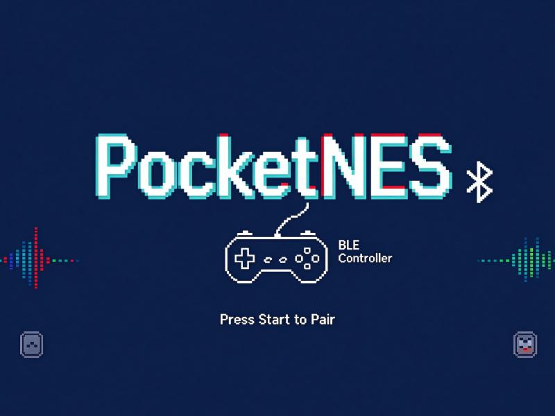
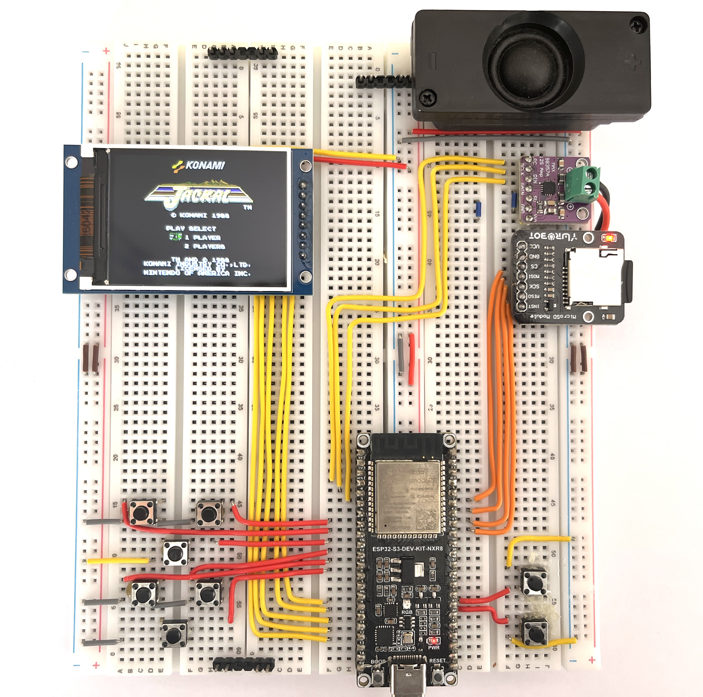
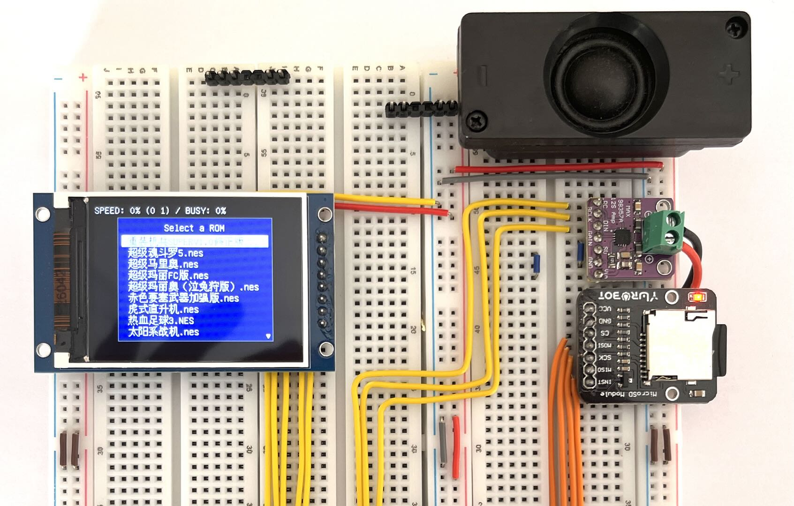
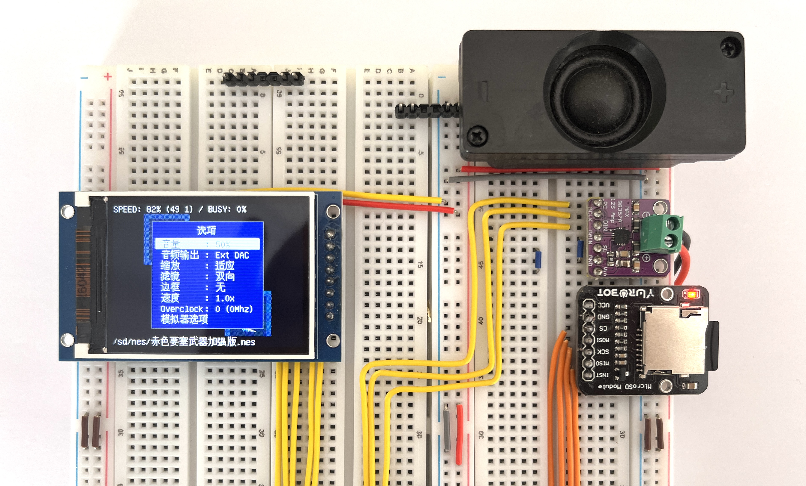

# PocketNES

一款面向 **ESP32-S3** 的掌机 **NES 模拟器固件** —— 使用 **PlatformIO** 构建，基于 [Retro-Go](https://github.com/ducalex/retro-go) 框架与 [nofrendo](https://github.com/ducalex/retro-go/tree/dev/cores) 核心，显示驱动采用 **LovyanGFX**，界面完整本地化为**简体中文**。

<div align="center">


</div>

<p align="center">
  <strong><a href="README_EN.md">English</a> | <a href="README.md">中文</a></strong>
</p>

把 `.nes` ROM 拷到 SD 卡，通过内置文件浏览器选中游戏，即可全速带声游玩。菜单、文件浏览器、设置、提示框等全部界面均提供简体中文。

同一份固件还可运行在微雪 **ESP32-S3-Touch-LCD-2.8** 开发板上，此时由 BLE 手柄替代实体按键 —— 详见[硬件](#硬件)。






## 功能特性

- **全速 NES 模拟** —— nofrendo 核心，支持 50+ 种 mapper，32 kHz I2S 音频输出
- **双硬件目标** —— 8 键掌机与无按键的微雪 ESP32-S3-Touch-LCD-2.8 共用同一套代码
- **LovyanGFX 显示后端** —— `Panel_ST7789` 独占 SPI3 总线，80 MHz 主频，DMA 推流，320×240 横屏界面
- **BLE 手柄输入** —— NimBLE HID 主机自动扫描、配对与重连，连接后状态栏显示蓝牙图标
- **软电源键** —— 微雪板的电池供电锁存由固件维持，长按约 2 秒可关机
- **完整简体中文界面** —— 206 条翻译文案 + 7544 字形的 16×16 点阵字库（语言菜单中仍可切换英文 / 法文 / 德文）
- **文件浏览器** —— 支持 UTF-8 文件名，超长文件名自动省略号截断，不再折行
- **即时存档** —— 每个 ROM 一个存档位，保存在 SD 卡
- **ZIP ROM 支持** —— 可直接加载 `.zip` 压缩包，无需解压
- **设置持久化** —— JSON 配置文件保存在 SD 卡（`/sd/retro-go/config`）
- **画面选项** —— overscan、自动裁剪、NES 调色板选择、精灵数量限制开关
- **一条命令构建与烧录** —— 基于 PlatformIO

## 硬件

同一套代码支持两种板型，按硬件选择对应的 PlatformIO 环境：

| 板型 | 屏幕 | 输入 | 编译环境 |
|------|------|------|----------|
| 8 键掌机（DIJI-NES） | ST7789 240×320 SPI | 8 个 GPIO 按键 | `nes-s3-st7789` |
| 微雪 ESP32-S3-Touch-LCD-2.8 | ST7789 240×320 SPI + CST328 触摸 | BLE 手柄 + BOOT/电源键 | `nes-s3-st7789-ble` |

### 8 键掌机（DIJI-NES）

| 部件 | 建议型号 | 说明 |
|------|----------|------|
| 主控 | ESP32-S3 模组，**N16R8** | 16 MB Flash，8 MB **OPI** PSRAM（`qio_opi`） |
| 屏幕 | ST7789 240×320 SPI 屏 | 横屏使用（320×240）；背光直接接 VCC |
| 音频 | MAX98357A I2S DAC/功放 | 单声道，32 kHz 采样率 |
| 存储 | microSD 卡（FAT32） | 使用独立 SPI 总线 |
| 输入 | 8 个轻触按键 | 低电平有效，内部上拉 |

硬件连接参考了 [DIJI-NES](https://github.com/UF-Evan/DIJI-NES)（UF-Evan）的设计。

屏幕与 SD 卡**必须**接在不同的 SPI 外设上 —— 固件将屏幕分配到 `SPI3_HOST`、SD 卡分配到 `SPI2_HOST`，避免两者争用总线。

### 引脚定义（8 键掌机）

**屏幕（SPI3）**

| 信号 | GPIO |
|------|------|
| SCLK | 14 |
| MOSI | 13 |
| DC | 11 |
| CS | 10 |
| RST | 12 |
| MISO | 未连接 |
| 背光 | 直接常亮 |

**microSD（SPI2）**

| 信号 | GPIO |
|------|------|
| MISO | 39 |
| MOSI | 41 |
| CLK | 40 |
| CS | 42 |

**I2S DAC（MAX98357A）**

| 信号 | GPIO |
|------|------|
| BCK | 5 |
| WS | 4 |
| DIN | 6 |

**按键**（低电平有效，接地触发）

| 按键 | GPIO | 按键 | GPIO |
|------|------|------|------|
| 上 | 17 | A | 48 |
| 下 | 3 | B | 47 |
| 左 | 8 | Select | 16 |
| 右 | 18 | Start | 15 |

### 微雪 ESP32-S3-Touch-LCD-2.8 + BLE 手柄

这是微雪的 [ESP32-S3-Touch-LCD-2.8](https://docs.waveshare.net/ESP32-S3-Touch-LCD-2.8/) 开发板（SKU 27690）。板上没有方向键、A/B 与 MENU 键，全部操作都来自 BLE 手柄：

- **输入** —— 方向键 / A / B / Select / Start 均由 BLE HID 手柄提供（见[按键操作](#按键操作)）；板上只保留 BOOT（GPIO 0）与 BAT 电源键，用于恢复菜单。
- **屏幕** —— 板载 ST7789：SPI3，SCLK 40 / MOSI 45 / DC 41 / CS 42 / RST 39，背光在 GPIO 5 上支持 PWM 调光（因此菜单里有亮度选项）。
- **SD 卡** —— microSD 卡座，SPI2：CS 21 / CLK 14 / MISO 16 / MOSI 17，时钟 5 MHz。
- **音频** —— 板载 PCM5101A DAC 与功放：BCLK 48 / LRCLK 38 / DIN 47，板上音量旋钮依然有效。
- **电源** —— 软开关锁存：BAT 电源键（GPIO 6）开机时接通供电，固件通过 GPIO 7 维持锁存。长按约 2 秒关机；短按在恢复菜单之外不做任何事。
- **电池** —— MX1.25 电池接口，GPIO 8 经 1:3 分压后接 ADC。

电容触摸屏（V1 为 CST328、V2 为 CST3530）、QMI8658 六轴传感器、PCF85063 RTC 与充电管理均未被固件使用。

完整引脚映射见 [`src/rg_core/targets/my-s3-st7789-ble/config.h`](src/rg_core/targets/my-s3-st7789-ble/config.h)。

<!-- TODO(photo)：拿到实拍图后替换本占位块，保持同一路径：
      -->

> **配图占位** —— `assets/pocketnes-28-ble.jpg`：微雪 ESP32-S3-Touch-LCD-2.8 连接 BLE 手柄的实拍图。

## 构建与烧录

依赖：[PlatformIO](https://platformio.org/)（Core 命令行或 VS Code 插件）和一根 USB 数据线。

```bash
# 编译 8 键掌机
pio run -e nes-s3-st7789

# 编译微雪 ESP32-S3-Touch-LCD-2.8（BLE 手柄）
pio run -e nes-s3-st7789-ble

# 烧录（自动检测串口，也可加 --upload-port COM5 / /dev/ttyUSB0 指定）
pio run -e nes-s3-st7789 -t upload
pio run -e nes-s3-st7789-ble -t upload

# 查看串口日志
pio device monitor -b 115200
```

板型配置为 `esp32-s3-devkitc-1`，`board_build.arduino.memory_type = qio_opi`，并使用自定义分区表 `partitions_nes.csv`（4 MB app 分区）。

## SD 卡目录结构

```
/sd/
├── nes/                  # 把 .nes 和 .zip ROM 放在这里
└── retro-go/
    ├── config/           # global.json、wifi.json、boot.json 等
    └── saves/            # 存档和每个 ROM 的独立设置
```

开机后文件浏览器默认打开 `/sd/nes`。

## 按键操作

| 按键 | 游戏中 | 菜单中 |
|------|--------|--------|
| 方向键 | 移动 | 导航 |
| A | A 键 | 确认 |
| B | B 键 | 返回 |
| Start | Start 键 | — |
| Select | Select 键 | — |
| **Start + Select** | **呼出菜单** | — |

游戏内菜单提供：继续游戏、存档、读档、重置、选项设置和截图。

### BLE 手柄（微雪开发板）

微雪板没有手柄按键，手柄就是唯一控制器。请把手柄切到 Android/BLE 模式（不是 X-input 或 Switch 模式）后开机 —— 固件会自动扫描，断线后自动重连。

| 手柄 | PocketNES |
|------|-----------|
| 方向键 | 方向键 |
| A | A |
| B | B |
| X | B |
| Y | A |
| Select | Select |
| Start | Start |
| **Start + Select** | **呼出菜单** |

手柄连接后，状态栏会显示蓝牙图标。

## 配置

硬件与构建期选项集中定义在所选 target 的 `config.h` 中：

- [`src/rg_core/targets/my-s3-st7789/config.h`](src/rg_core/targets/my-s3-st7789/config.h) —— 8 键掌机
- [`src/rg_core/targets/my-s3-st7789-ble/config.h`](src/rg_core/targets/my-s3-st7789-ble/config.h) —— 微雪 ESP32-S3-Touch-LCD-2.8

主要选项：

- `RG_SCREEN_HOST` / `RG_SCREEN_SPEED` —— 屏幕总线与时钟（SPI3 @ 80 MHz）
- `RG_LGFX_ROTATION`、`RG_LGFX_INVERT`、`RG_LGFX_RGB_ORDER` —— 屏幕方向与色彩模式
- `RG_GPIO_*` —— 屏幕、SD 卡、I2S 和按键的引脚映射
- `RG_LANG_DEFAULT`、`RG_FONT_DEFAULT` —— 默认界面语言与字体
- `RG_INPUT_BLE_GAMEPAD` —— 启用 NimBLE 手柄驱动（仅 BLE target）
- `RG_GPIO_PWR_KEY` / `RG_GPIO_PWR_HOLD` —— 软电源键与锁存（仅 BLE target）

> **屏幕注意事项：** 部分 ST7789 克隆屏的 MADCTL BGR 位**极性是反的**（0xB0 = 蓝色高位，0xB8 = 红色高位）。本目标使用 `rgb_order = false`（MADCTL 0xB8），`lcd_send_buffer()` 只负责还原字节预交换。如果你的屏幕红蓝互换，请翻转 `RG_LGFX_RGB_ORDER`。

## 项目结构

```
├── platformio.ini              # PlatformIO 环境、编译选项、include 路径
├── partitions_nes.csv          # NVS / OTA / 4 MB app 分区表
├── startup.png                 # 开机画面（编译期嵌入固件，lodepng 解码）
├── lib/LovyanGFX/              # 本地 LovyanGFX（已剔除大型中日韩字库）
├── lib/NimBLE-Arduino/         # 本地 NimBLE-Arduino 1.4.3（仅 BLE target 使用）
└── src/
    ├── main.cpp                # Arduino 入口：rg_system_init() + 模拟器任务
    ├── shared.h                # C/C++ ABI 边界
    ├── nes_main.c              # nofrendo 主循环、画面输出、输入、音频、事件回调
    ├── nofrendo/               # NES 核心 + 50+ 种 mapper
    └── rg_core/                # Retro-Go 框架
        ├── rg_display.c        # 流式显示管线
        ├── rg_gui.c            # 对话框与文本引擎（省略号截断等）
        ├── rg_audio.c          # I2S 音频输出
        ├── rg_settings.c       # JSON 设置持久化
        ├── rg_pwrkey.c         # 软电源键：开机锁存、长按约 2 秒关机
        ├── drivers/input/
        │   └── ble_gamepad.{h,cpp}       # NimBLE HID 手柄主机
        ├── drivers/display/
        │   ├── lovyangfx_bridge.{h,cpp}  # 供 rg_display.c 使用的 C++ 桥接层
        │   └── lovyangfx.h               # lcd_* C 接口
        ├── fonts/efontCN16.c   # 16×16 中文点阵字库（7544 字形）
        └── targets/
            ├── my-s3-st7789/config.h     # 8 键掌机
            └── my-s3-st7789-ble/config.h # 微雪 ESP32-S3-Touch-LCD-2.8（BLE）
```

## 架构说明

- **启动链路：** `main.cpp` → `rg_system_init()`（初始化屏幕、音频、输入、存储、设置）→ `startup.png` 开机画面（约 1.5 秒后清屏）→ `nes_main()`，此后不再返回。
- **渲染：** 两块 `RG_PIXEL_PAL565_BE` 表面交替写入；`blit_screen()` 按 overscan / 自动裁剪处理后，由 `rg_display_submit()` 推流到屏幕。调色板在构建时统一做字节交换，使 GUI 与游戏两条路径共用同一套字节序约定。
- **LovyanGFX 桥接：** `rg_display.c` 是纯 C 代码，因此由 `lovyangfx_bridge.cpp` 以 `extern "C"` 暴露一套小型 API（`rg_lgfx_*`）。推流时 `setWindow()` 必须包在 `startWrite()/endWrite()` 内（底层窗口命令不会自行开启 SPI 事务），随后调用 `pushPixels()`。
- **BLE 输入：** `ble_gamepad.cpp` 内有一个 NimBLE 扫描/连接任务，把手柄按键通过 `rg_ble_gamepad_get_state()` 暴露出来，`rg_input.c` 将其并入常规手柄状态。未定义 `RG_INPUT_BLE_GAMEPAD` 的 target 会把整个实现编译掉。
- **GUI 文本引擎：** `rg_gui.c` 中的自研点阵字体渲染器，支持 UTF-8 解码、多行排版、对齐，以及 `RG_TEXT_ELLIPSIS` 单行省略号截断。
- **中文字库：** `efontCN16.c` 由 u8g2 的 `lgfx_efont_cn_16` 表转换而来，采用定长记录存储，`find_glyph()` 可对其二分查找。

## 致谢与许可

本项目离不开以下开源项目：

- [Retro-Go](https://github.com/ducalex/retro-go)（ducalex）—— 框架、GUI、设置系统、音频管线
- [nofrendo](https://github.com/ducalex/retro-go/tree/dev/cores) —— NES 模拟核心
- [LovyanGFX](https://github.com/lovyan03/LovyanGFX)（lovyan03）—— 显示驱动
- [NimBLE-Arduino](https://github.com/h2zero/NimBLE-Arduino)（h2zero）—— 手柄用的 BLE HID 主机
- [DIJI-NES](https://github.com/UF-Evan/DIJI-NES)（UF-Evan）—— 8 键掌机硬件连接与引脚定义参考
- [Waveshare ESP32-S3-Touch-LCD-2.8](https://docs.waveshare.net/ESP32-S3-Touch-LCD-2.8/) —— 2.8 寸测试板及其官方引脚定义
- [u8g2 / efont](https://github.com/olikraus/u8g2)（olikraus）—— 中文字形数据
- [cJSON](https://github.com/DaveGamble/cJSON) 与 [lodepng](https://lodev.org/lodepng/)

Retro-Go 与 nofrendo 采用 **GPL-2.0** 许可，因此本项目同样以该许可发布。完整许可文本见 `LICENSE`。
